# Space Words

Reading and math games for young kids (kindergarten to about 3rd grade), with a friendly voice
that reads everything aloud. It runs offline as an Android app, in one of two ways:

- **On any Android phone or tablet** (Android 5.1 or newer): a normal app with its own icon.
  See [Install on a phone or tablet](#install-on-a-phone-or-tablet).
- **On a Skylight photo frame**: a floating UFO button over the slideshow opens the games.
  See [Install on a Skylight frame](#install-on-a-skylight-frame).

Both are built from this repo and run the same games (app/src/main/assets/www).

**Keep this repo and the app files private.** The voice clips were recorded with edge-tts, an
unofficial client for Microsoft's text-to-speech service, so they can't be shared publicly.

## Screenshots

<table>
<tr>
<td width="50%">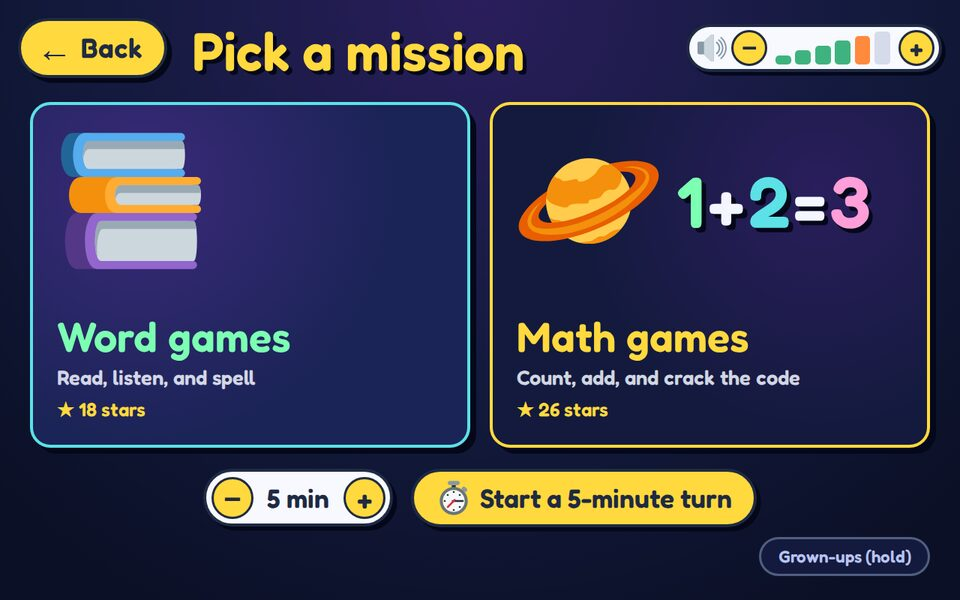 Pick a mission</td>
<td width="50%">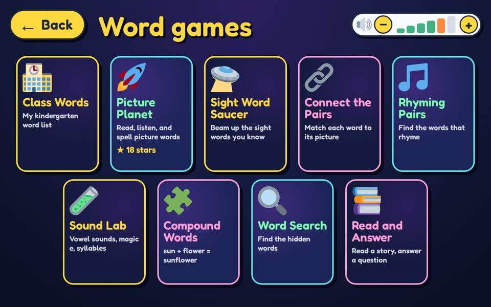 Word games</td>
</tr>
<tr>
<td width="50%">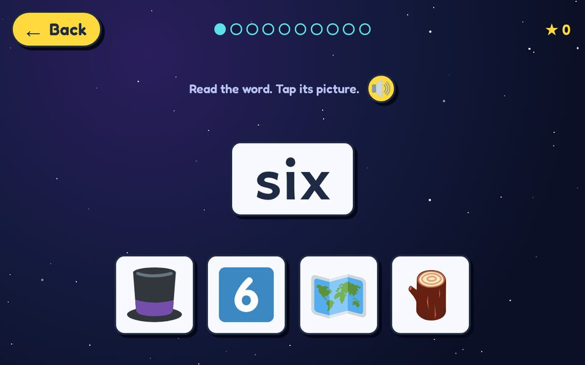 Picture Planet: read the word, tap its picture</td>
<td width="50%">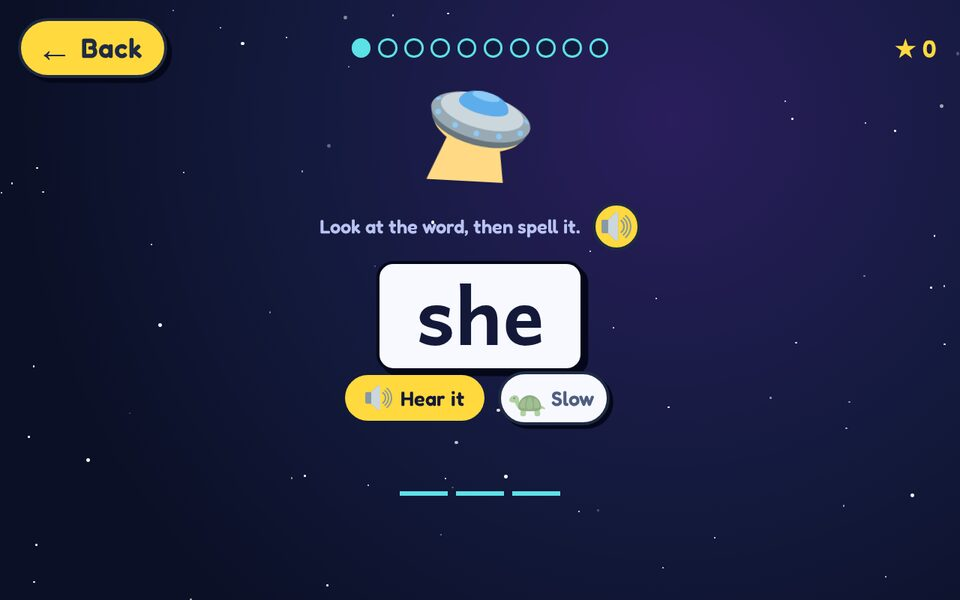 Sight Word Saucer: look, then spell it</td>
</tr>
<tr>
<td width="50%">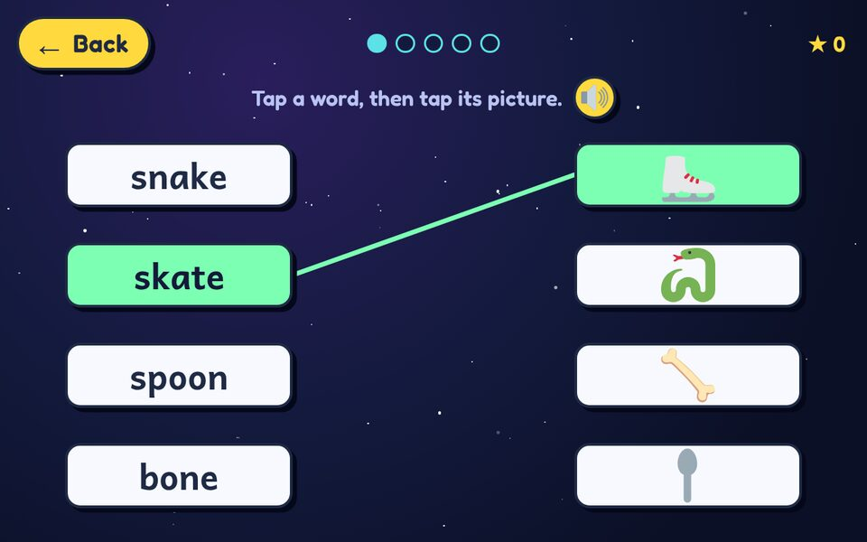 Connect the Pairs</td>
<td width="50%">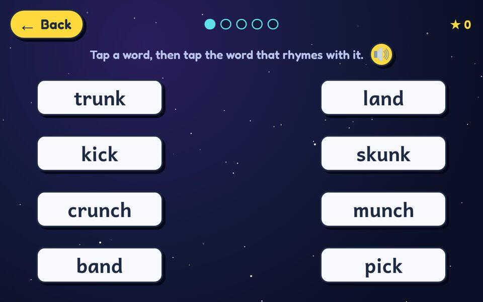 Rhyming Pairs</td>
</tr>
<tr>
<td width="50%">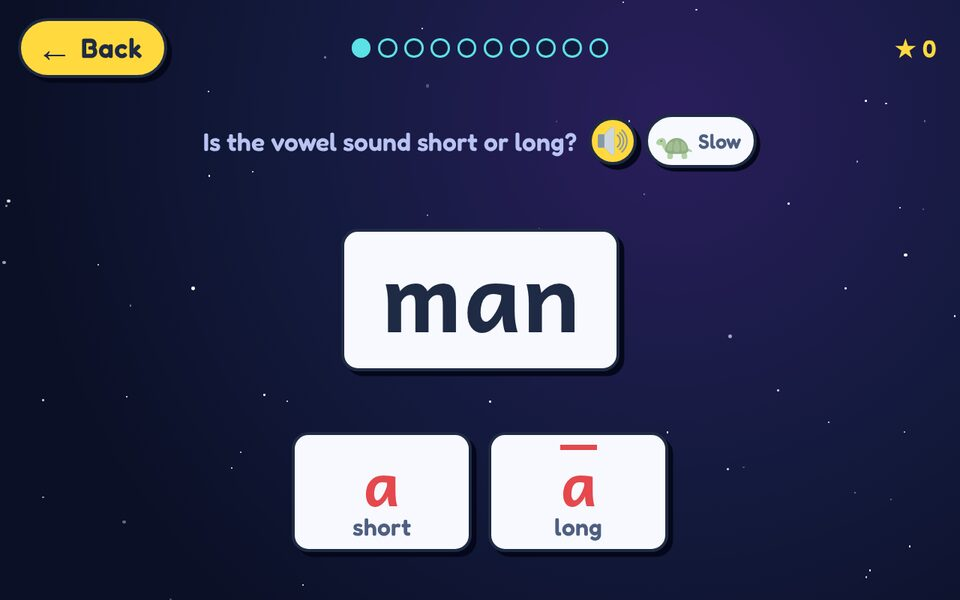 Sound Lab: short or long vowel?</td>
<td width="50%">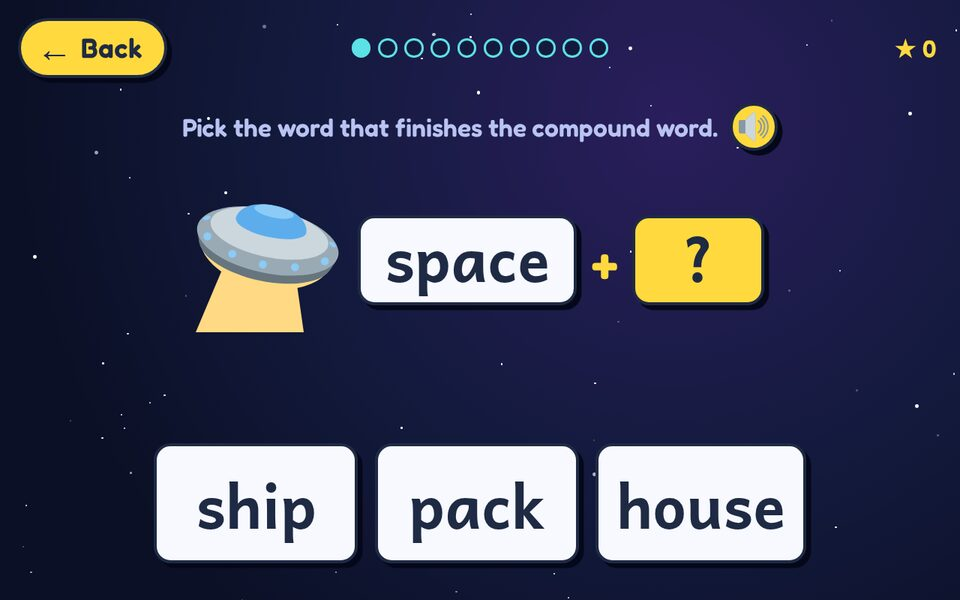 Compound Words</td>
</tr>
<tr>
<td width="50%">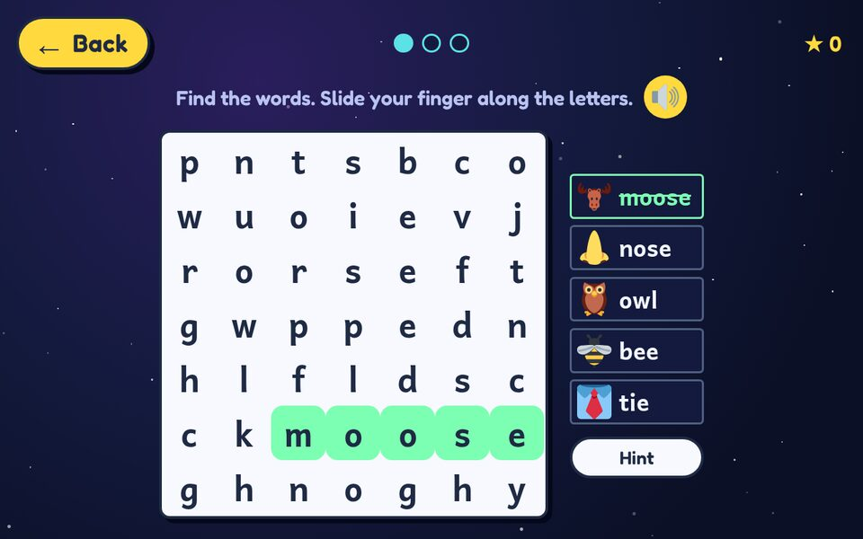 Word Search (slide a finger along the word)</td>
<td width="50%">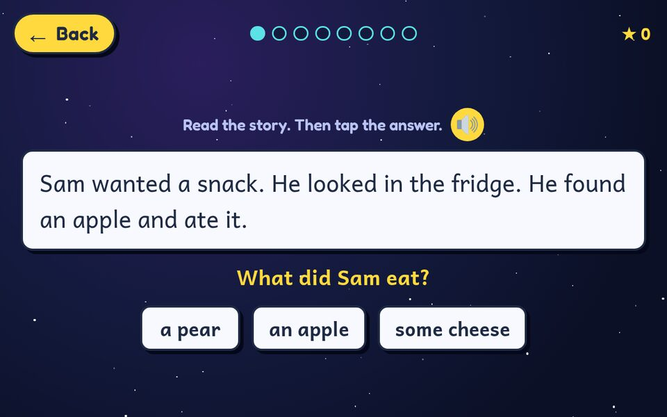 Read and Answer</td>
</tr>
<tr>
<td width="50%">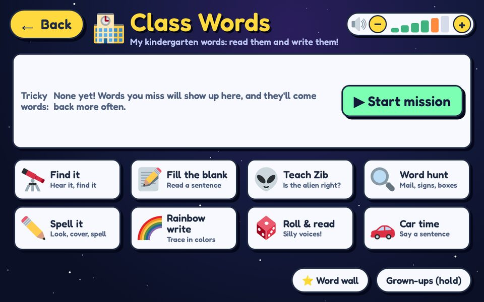 Class Words</td>
<td width="50%">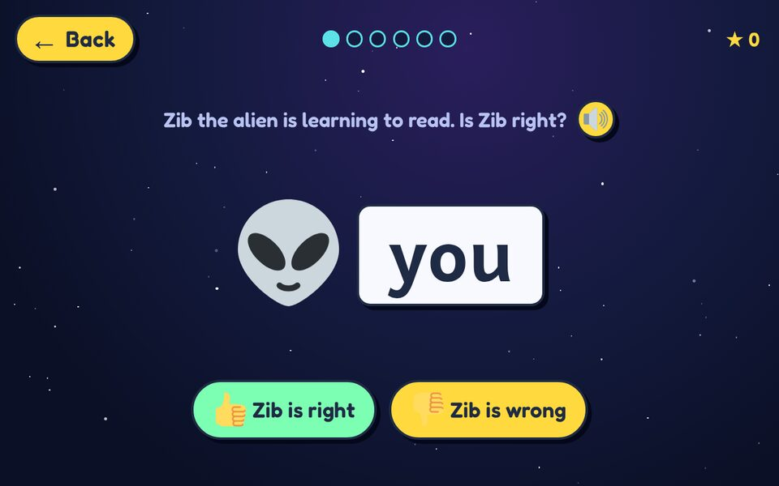 Class Words: teach Zib the alien</td>
</tr>
<tr>
<td width="50%">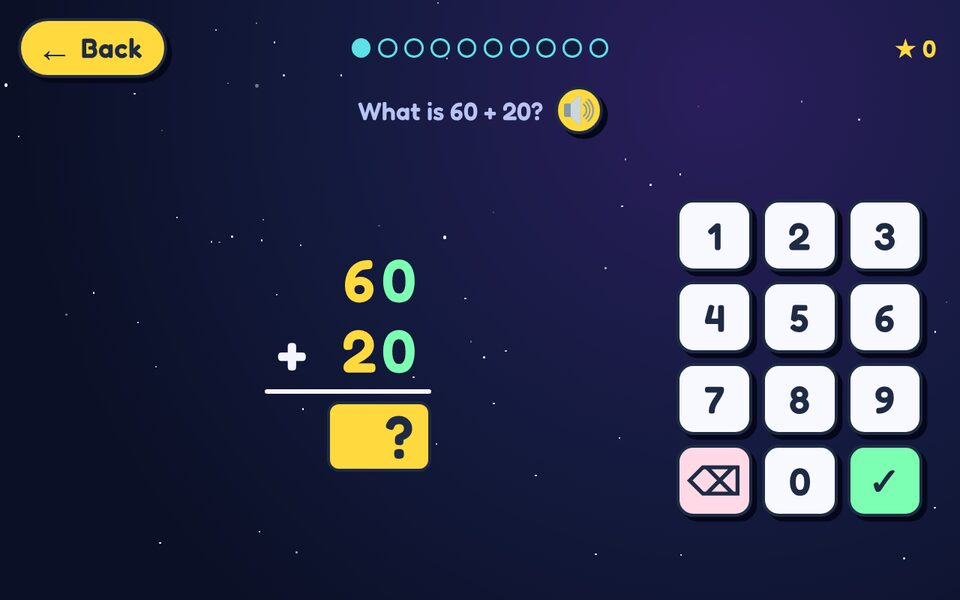 Rocket Math, stacked like on paper</td>
<td width="50%">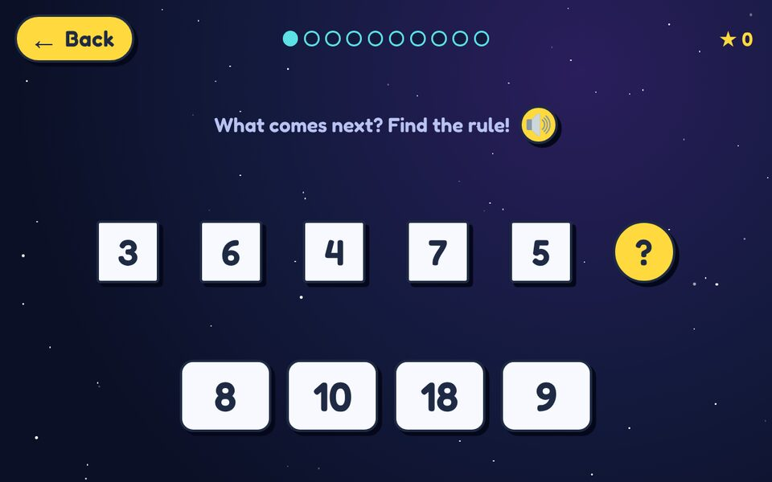 Alien Patterns: find the rule</td>
</tr>
</table>

On a phone, upright:

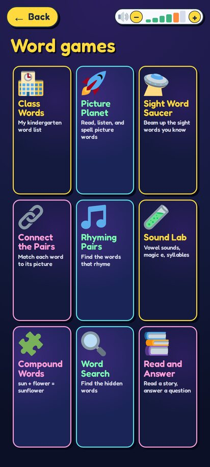 &nbsp; 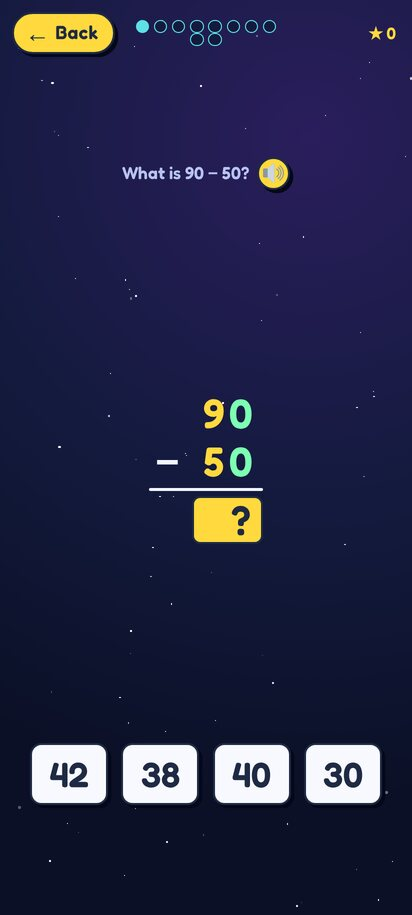

## The games

Tap "Pick a mission":

**Word games**
- **Class Words** - a kindergarten class list (69 words to read and write), with the class
  handout's practice ideas built in: word hunts on space mail, signs and cereal boxes; saying a
  sentence ("car time"); teaching Zib the alien, who sometimes reads wrong; rainbow tracing; and
  roll & read with silly voices. Words take turns by themselves: missed words come back more
  often, known ones less. "Tricky words" shows the ones to practice, the Word wall shows how
  many are learned, and press-and-hold "Grown-ups" shows progress on every word.
- **Picture Planet** - picture words: read it, hear it, spell it.
- **Sight Word Saucer** - Dolch sight words across five planets (Pre-primer to Grade 3):
  hear a word and beam it up, pick the word that fits a sentence, or look-cover-spell.
- **Connect the Pairs** - tap a word, then its picture; a line joins them. Picture Planet's
  five word levels, 3 to 5 pairs per board.
- **Rhyming Pairs** - tap two words that rhyme: short vowels (cat, hat), long vowels
  (cake, lake), same sound with new spelling (blue, shoe), and two-part words (kitten, mitten).

- **Sound Lab** - pronunciation: every vowel has its own color, long vowels get a bar on top,
  silent e is gray, vowel teams and bossy R are underlined. Levels: short vowels (swap the
  vowel in b_g to hear bag, beg, big, bog, bug), magic e (cap, cape), vowel teams (rain, boat),
  syllables (clap and count; tap each part to hear it), and bossy R (car, fork, bird).

- **Compound Words** - sun + flower = sunflower: picture puzzles, match the halves, split it
  (tap between the letters), build it, and big words like thunderstorm. Wrong choices are
  checked so they never make a real word too (sun + set would).

- **Word Search** - find Picture Planet's words in a letter grid by sliding a finger along
  them; five levels from 5x5 across-only to 10x10 every direction.
- **Read and Answer** - read a short story, then answer a question about it: who/what/where,
  yes or no, put three events in order, or pick the matching pictures. Six levels, up to
  "think about it" questions and longer stories. The story isn't read aloud (that's the point),
  but any word in it can be tapped to hear it.

Now and then a bonus "Which way?" question pops up between rounds (left/right/up/down or
north/south/east/west).

The volume control sits in the top-right corner of the pickers and level lists. Tap -, +,
or a bar. All bars off is silent; the two orange bars boost the voice past the device's normal
maximum.

Next to "Hear it" there's a turtle switch. While it's on (green), every word is said slowly;
instructions and praise stay normal. It stays on until she taps it off.

In every game, tapping a word that isn't an answer choice reads it aloud (instructions,
sentences, numbers in math questions). In Picture Planet's "read the word" rounds that counts
as a hint, like Peek, and costs the round's gold star.

**Math games** (five levels each, from kindergarten starter to about 3rd grade)
- **Star Count** - count to 10 and 20, more or fewer, numbers to 100, tens and ones.
- **Rocket Math** - add to 5 with pictures, add and take away, facts to 20, two-digit
  numbers, times and sharing. Harder levels use a number keypad instead of choices.
- **Alien Patterns** - picture patterns, counting up and down, skip counting,
  number rules, and brain busters like 1, 2, 4, 8.

Every screen has the same yellow Back button in the top-left corner; it goes back one step at a
time, and so does the device's Back key. Stars for each level are saved on the device. On
"Pick a mission", - and + set a turn length (1 to 5 minutes) and "Start a turn" counts it down,
then says "Switch turns!", handy when siblings share.

## Install on a phone or tablet

A separate app (id `com.wordhop.home`, in the `home/` folder) that shows the games full screen,
both ways up. Compared with the Skylight version there's no UFO and no "Hide for N hours", and
Back on "Pick a mission" closes the app. The voice clips are all in the repo, so no recording
is needed.

### Easiest: download the ready-made app

**[Download SpaceWords-Android.apk](https://github.com/ControlFreakEv/SpaceWords/raw/master/download/SpaceWords-Android.apk)**
(54 MB, the latest build, version 1.4; it's in the [download](download) folder)

1. On the phone or tablet, open this page in a browser (Chrome) signed in to GitHub, since the
   repo is private, and tap the link. (In the GitHub app, open the link in the browser instead.)
2. Open the downloaded file (from the download notification or the Files app). That starts
   Android's installer.
3. The first time, Android asks to allow installing apps from the browser ("Install unknown
   apps"): allow it, go back, and tap **Install**. If Play Protect warns about an unknown app,
   tap "More details" > "Install anyway"; it just isn't from the Play Store.
4. "Space Words" appears with the other apps.

On a kids' account managed with Google Family Link, a parent has to allow the install. On an
Amazon Fire tablet, turn on Settings > Security & Privacy > Apps from Unknown Sources (for
Silk or Files) first. A newer download installs over the old one and keeps the stars.

### Build it yourself
You need Git, the Android SDK, and Java 17 to 21. Installing Android Studio covers both; its
bundled Java works. Java 22+ won't run this project's Gradle 8.7, and please decline Android
Studio's offer to upgrade the Android Gradle plugin.

    git clone https://github.com/ControlFreakEv/SpaceWords.git
    cd SpaceWords
    gradlew.bat :home:assembleDebug          (Windows)
    ./gradlew :home:assembleDebug            (macOS / Linux)

If Gradle can't find the SDK, create `local.properties` with
`sdk.dir=C\:\\Users\\you\\AppData\\Local\\Android\\Sdk` (Windows) or
`sdk.dir=/home/you/Android/Sdk`. If it picks the wrong Java, set `JAVA_HOME` first, e.g.
`set JAVA_HOME=C:\Program Files\Android\Android Studio\jbr`.

The APK lands in `home/build/outputs/apk/debug/home-debug.apk`. Install it with USB debugging on:

    adb install -r home/build/outputs/apk/debug/home-debug.apk

or copy the file to the device and tap it. In Android Studio you can instead open the folder,
pick the **home** run configuration and press Run.

To update: `git pull`, build again, and install over the old copy (`-r`); stars are kept. Every
build is signed with the same key (`home/spacewords-home.jks`, in the repo), so an update built
on any computer installs over any other.

On Windows, **android-app.bat** does all of this in one go (pull, record any new clips, build)
and leaves `SpaceWords-Android.apk` in the folder. Recording needs Python and edge-tts; add
`-SkipAudio` if you don't have them (the clips in the repo are enough):
`powershell -ExecutionPolicy Bypass -File tools\update.ps1 -AndroidApp -SkipAudio`

Uninstall: from the device's app list, or `adb uninstall com.wordhop.home`.

## Install on a Skylight frame

A floating UFO button sits on top of the Skylight slideshow; tap it to open the games, and drag
it to move it. The games open in a full-screen window floating over the slideshow, so Skylight
keeps running underneath and Back on "Pick a mission" returns to the photos at once. The game
closes by itself after 10 minutes without a touch. Grown-ups can press and hold "Grown-ups" on
"Pick a mission" to hide Space Words for 1 to 24 hours.

This needs adb access to the frame. Ours (Android 5.1, 1280x800) allowed it over USB and then
Wi-Fi; not every Skylight frame does. The scripts below assume Windows and our frame's address
(192.168.1.242); pass `-Frame <address>:5555` to use another.

### Updating the frame (the usual routine)
Double-click **update.bat** in this folder. It runs the four steps in order and stops with
a plain message if one fails:

1. git pull (latest code)
2. python tools\make_audio.py (records only the clips that are new), then uploads new clips
   to GitHub so builds made elsewhere have the whole voice too. If the upload fails it says so
   and carries on; it tries again next time.
3. build the APK (same as Android Studio's Generate APKs)
4. tools\deploy.ps1 (install on the frame over Wi-Fi, or USB if Wi-Fi isn't answering)

From a terminal instead: `powershell -ExecutionPolicy Bypass -File tools\update.ps1`
Add `-Open` to open the games afterwards, or `-SkipAudio` to skip recording.

The steps it runs, for doing them by hand:

### 1. Record the voice (only when new spoken text was added)
Needs Python 3 on your PC (python.org) and internet for a few minutes.
Open Command Prompt in this SpaceWords folder (not platform-tools), then:

    pip install edge-tts
    python tools\make_audio.py

That saves MP3 clips (about 4,700) into app/src/main/assets/www/audio. They're already in the
repo; it only records clips that are missing, so run it after an update that adds new spoken
text, then rebuild. (The frame has no usable text-to-speech engine, so the games use these clips.)
To hear other voices:  python tools\make_audio.py --list
To switch voices:      python tools\make_audio.py --voice en-US-AnaNeural --force

### 2. Build (Android Studio)
1. File > Open > this SpaceWords folder. Wait for the Gradle sync bar at the bottom to finish
   (the Build menu items stay grey until it does). Decline the Android Gradle plugin upgrade.
2. Pick the **app** run configuration (not home), then Build > Generate App Bundles or APKs > Generate APKs.
   (Older Android Studio versions call this Build > Build Bundle(s) / APK(s) > Build APK(s).)
3. A "Build APK(s)" popup appears when it is done; its "locate" link opens the folder.
   The APK lands in app/build/outputs/apk/debug/app-debug.apk

Or from a terminal in this folder (uses Android Studio's Java; adjust the path if yours differs):

    set JAVA_HOME=C:\Program Files\Android\Android Studio\jbr
    gradlew :app:assembleDebug

### 3. Install on the frame (ADB already working)
    adb install -r app\build\outputs\apk\debug\app-debug.apk
    adb shell am start -n com.wordhop.app/.GameActivity

On Android 5.1 the floating-button permission is granted at install.
On newer Android, also run:
    adb shell appops set com.wordhop.app SYSTEM_ALERT_WINDOW allow

Stars are kept across reinstalls with -r.

### Updating over Wi-Fi (no USB cable)
The frame is set up for Wi-Fi adb at 192.168.1.242 (reserve that address for it in your router,
hardware address e0:cb:56:8c:bd:58). After building a new APK, from this folder run:

    powershell -ExecutionPolicy Bypass -File tools\deploy.ps1

Add -Open at the end to open the games afterwards for a quick test. Installing closes the
app, and this frame's software won't let it restart itself in the background, so the script
starts the UFO again (opening the game on the frame if that's the only way).

The same frame rule blocks the usual "start after reboot" message, so the UFO comes back
another way: deploy.ps1 registers it as a notification listener (Android starts those at
boot), with a 15-minute background job as a fallback.

One-time setup so Wi-Fi adb survives reboots (frame plugged in by USB, or already connected):

    adb tcpip 5555
    adb connect 192.168.1.242:5555
    adb root
    adb connect 192.168.1.242:5555
    adb shell setprop persist.adb.tcp.port 5555

Turn it off again with:  adb shell setprop persist.adb.tcp.port ""  then reboot.
Note: this frame reports ro.adb.secure=0, so any device on your Wi-Fi can connect to it
without a prompt while Wi-Fi adb is on.

### Troubleshooting scripts (run from this folder)
    powershell -ExecutionPolicy Bypass -File tools\diagnose-back.ps1     slow "Back to photos", missing UFO
    powershell -ExecutionPolicy Bypass -File tools\inspect-autostart.ps1 why the app can't start itself
Both only read from the frame, save a log in tools\, and copy it to the clipboard.

### If the Skylight app keeps jumping in front of the game
    adb shell pm disable-user --user 0 skylight.watchdog
Undo with:
    adb shell pm enable skylight.watchdog

### Uninstall
    adb uninstall com.wordhop.app

To show the UFO again early after "Hide for N hours": double-click unhide.bat.

## Credits
Pictures: Twemoji by Twitter and contributors, CC-BY 4.0.
Fonts: Andika (SIL) and Fredoka, SIL Open Font License.
Word lists: Dolch sight words.

App ids never change (com.wordhop.app on the frame, com.wordhop.home on phones and tablets),
so reinstalls keep the stars.
